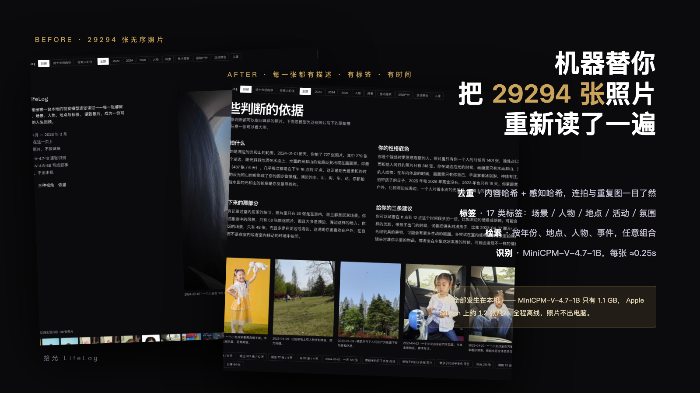
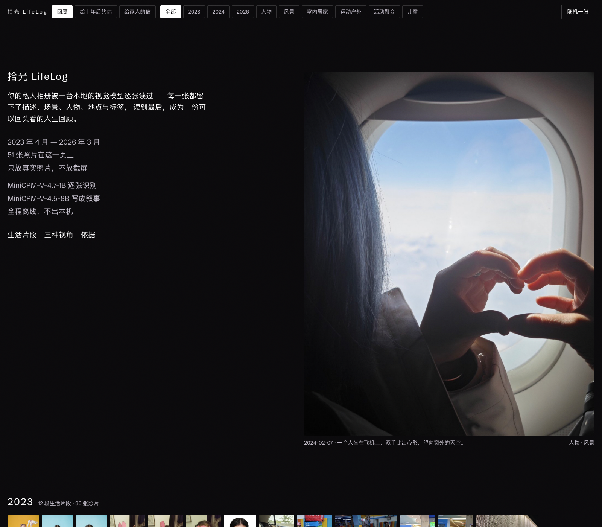
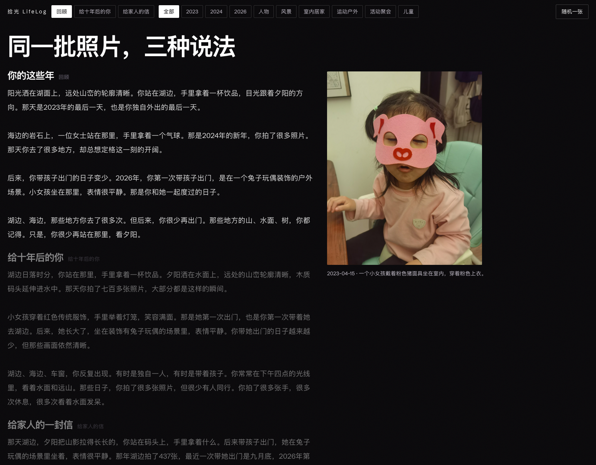
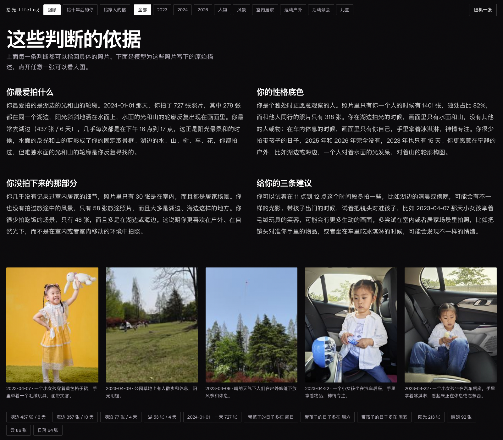

<div align="center">

# 拾光 LifeLog

**Your local photo library, understood one photo at a time by MiniCPM, becomes a life review you can look back on**

[中文](README.md) | **English**

[](https://tailwindcss.com) [](https://github.com/OpenBMB/MiniCPM-V) [](https://github.com/ggml-org/llama.cpp) [](https://modelcontextprotocol.io)

[Quick Start](#quick-start) · [Three Narrative Voices](#three-narrative-voices) · [Self-Portrait](#self-portrait-and-its-evidence) · [Application Materials](docs/报名材料.md) (in Chinese)

</div>
---
## The Pain Point

Ten years with a Xiaomi phone left me with **29294 photos** — hundreds of gigabytes of memories.

It's not that I don't want to revisit them; it's that I **can't get through them**: duplicates, that one photo I can't find, a trip I can't place in a year. Delete them? I might lose something that matters. Keep them? They just sit there, getting heavier.

LifeLog does three things, then writes a fourth:

1. **Dedupe** · Content hash + perceptual hash — burst shots, duplicates and RAW+JPG pairs are obvious at a glance;
2. **Reorganize** · 17 categories of tags + date + place + people + activity + mood, so every photo lands where it belongs;
3. **AI captioning** · MiniCPM-V-4.7-1B looks at each photo and writes down "what happened";
4. **Life review** · Those descriptions are grouped into days, strung into episodes and measured for patterns; MiniCPM-V-4.5-8B then writes three narratives and a portrait of you — so you can truly **recall these ten years**.

<div align="center">


</div>

---

## Why MiniCPM (Instead of a Cloud Multimodal Model)

**This is a local-first project.** A photo library is the most private data there is; any "upload to the cloud for recognition" scheme means handing over every frame of ten years of your life. So the first hard requirement for the model is: **it must process tens of thousands of photos entirely offline, on a consumer machine with 16 GB of RAM.**

| Candidate model | Smallest usable size | Runs on a 16 GB Mac | Per-photo throughput | Verdict |
| --- | --- | --- | --- | --- |
| GPT-4V / Claude | — | Requires upload | — | Privacy red line — ruled out |
| **MiniCPM-V-4.7-1B** | **1.1 GB (Q8)** | **Yes** | **~1.2 photos/sec** | **Primary captioning model** |
| MiniCPM-V-4.5-8B | 5.0 GB (Q4) | Yes (ctx 4096) | ~40 s/piece | **Deep understanding & writing** |
| MiniCPM-V-4.7-35B-A3B | 14.5 GB (IQ3) | No | — | Doesn't fit in 16 GB |

**Three reasons for choosing MiniCPM:**

1. **Size**: the 1B model at Q8 quantization is only 1.1 GB and takes about 2 GB of RAM once loaded — the only tier that can **coexist** with the OS, a browser and a database on a 16 GB machine and run for hours straight;
2. **Speed**: measured **1.2 photos/sec (4-way concurrency)** with Apple Silicon Metal acceleration — even a 50,000-photo library finishes within half a day, which turns "understand the whole library" from a demo into a routine;
3. **Official GGUF support**: OpenBMB publishes llama.cpp-ready GGUF builds directly, including the 1B, the 4.5-8B and a dedicated OCR model — no format conversion needed.

**Three tiers of models** (one table on why three are needed):

| Model | Size | Role | Measured throughput |
| --- | --- | --- | --- |
| MiniCPM-V-4.7-1B (Q8) | 1.1 GB | Whole-library captioning: scene / people / place / activity / mood / tags | 1.2 photos/sec |
| MiniCPM-V-4.5-8B (Q4) | 5.0 GB | Deep understanding + three narratives + self-portrait | ~40 s/piece |
| MiniCPM-OCR-1.0 (Q8) | 0.8 GB | Text extraction from screenshots, orders, tickets and signs | — |

---

## Measured Data

**Test machine**: Apple M6 · 16 GB unified memory · macOS 27 · llama.cpp 0.8.0 · Python 3.15

**Throughput** (back-computed from the real captioning timestamps in `data/lifelog.sqlite`):

- MiniCPM-V-4.7-1B · 4-way concurrency · 1957 photos in **49 minutes** (~0.67 photos/sec actual ingest rate)
- Median per-item interval 1.00 s (with 4 slots, each slot averages ~0.25 s/photo)
- Writing (4.5-8B): a single day review takes 10-15 s, a full portrait 22 s, all three narratives 16 s
- **The full library of 29,294 photos takes ~6-7 hours per pass** — leave it running overnight; resumable at any point

**Quality sampling**: all 226 sampled photos produced parseable structured JSON; 14 items initially failed to parse (the model occasionally drops a comma) — after adding a fault-tolerant parser, **0 photos needed a manual re-run**.

---

## A Real Q&A Demo

`python scripts/gen_demo.py` generates a self-contained page from your local library, `reports/demo/qa-demo.html` (just double-click to open). It embeds the presenter's private photos, so it isn't distributed with the repo — only the generator script is. Two rounds of Q&A look like this:

- **Where do I work** — filtered 2023 by "desk / workstation / office lobby" clues: 32 photos across 21 dates, 5 of them with GPS: Oriental Fisherman's Wharf Area A, Yangpu (2 office-scene photos), Nanjing East Road, Huangpu (30 days / 93 photos, 2 of them workstations).
- **Where should I take friends** — recommended Sun Bay, Sanya, 2023-06-03~05: 958 photos in the same coordinate cluster over three days, all captioned — outdoors 214 / seaside 184 / indoors 181 / mountains 52, peaking at 17:00 and 22:00.

The page also shows the original thumbnails, capture times and the model's descriptions, so everything can be checked directly. After generating, you can also view it at `http://127.0.0.1:8766/demo`.

---
## Demo

Contact sheet (the whole library spread out by year):



Three narratives (three ways of telling the same set of photos):



Self-portrait (every judgment backed by photo details):



**English intro video**: `marketing/lifelog-promo-en.mp4` (105 s, 17.7 MB).

Chinese versions: **dynamic version** at `marketing/promo-slideshow.mp4` (19 s loop, 3 MB); **Apple-style promo** at `marketing/lifelog-apple-promo.mp4` (52 s, 1080p).

---

## Quick Start

**Requirements**: an Apple Silicon Mac (M-series chip), 16 GB RAM, Python 3.11+, Node 20+ (to build the CSS), the Xiaomi Cloud app (if syncing from the cloud).

```bash
# 1) Clone
git clone https://github.com/lengjingxu/lifelog-minicpm.git
cd lifelog-minicpm

# 2) Install dependencies
python3 -m venv .venv && .venv/bin/pip install pillow pillow-heif
npm install          # Tailwind CSS v4

# 3) Download the model (first time ~2 GB; resumable via hf-mirror)
.venv/bin/python scripts/fetch_models.py minicpm-v-4.7-1b

# 4) Pull a date range of photos from Xiaomi Cloud (or use a local photo folder)
.venv/bin/python -m lifelog.cli sync --start 20240101 --end 20240331
# or incremental: .venv/bin/python -m lifelog.cli sync --incremental

# 5) Caption + aggregate + portrait & narratives, in one command
.venv/bin/python -m lifelog.cli weekly --sample 100

# 6) Start the review page
.venv/bin/python -m lifelog.cli serve-web --port 8766
# Open http://127.0.0.1:8766/review
```

**Just want to see the effect**: `bash scripts/demo.sh /path/to/photos 4` samples 100 photos and runs the full pipeline within 5 minutes.

---

## Merging Multiple Models (The Core of This Fix)

An early batch was run with Qwen3-VL, then we switched to MiniCPM-V-4.7-1B — so the database ended up holding two sets of descriptions, and statistics simply added them together: coverage briefly read **188.5%** (55205 / 29294), and core figures like the "time-alone ratio" were polluted too.

The fix isn't naive deduplication — the two result sets are **merged**:

| Field | Rule | Why |
| --- | --- | --- |
| Caption body | MiniCPM is primary; the secondary model's text is kept in `caption_alt` and joins retrieval too | Switching models shouldn't discard historical results |
| Scene / people / place / mood | **Primary model only** | These fields directly drive conclusions like the time-alone ratio |
| Activity | Filled from the secondary model when the primary is empty | Qwen's column is reliable here |
| Tags | Union after normalizing both sides to the 17-category vocabulary; "people" counts only from the primary model | Qwen sometimes mislabels empty scenes as people |

- The vocabulary lives in `TAG_TAXONOMY` in `lifelog/config.py` (e.g. `户外/山野/海边/雪地 → 风景` — outdoors/mountains/seaside/snow → landscape, `手机/电脑/截图 → 屏幕截图` — phone/computer/screenshot → screenshot, `家具/家居 → 室内居家` — furniture/home furnishing → indoor-at-home …)
- The merger is `scripts/merge_captions.py`, run automatically as step 4 of the `lifelog weekly` pipeline
- The output is a `merged_caption` table + a `current_caption` view; every query reads the view,
  so the definitions can't drift again

Result: 29283 photos (99.96%), of which **25922 are cross-validated by both models**, and 15980 had their tags completed.

## Three Narrative Voices

One factual record, three different ways of telling it, switchable with one click at the top of the page:

| Voice | What it reads like |
| --- | --- |
| **Your Years** | A friend who has just gone through your album, talking to you in person, picking out a few concrete moments from these years |
| **A Letter to Yourself in Ten Years** | Plain statements about your routines, companionship and state of mind back then — no pep talk, no lyricism |
| **A Letter to Family** | A first-person text message: facts only, ending on one small, concrete thing |

Writing constraints (baked into the prompts): short sentences, no metaphors, no sentimentality, no uplift, no piling on adjectives; every number must quote the program-computed "fact whitelist" verbatim — the model may not convert or invent figures.

Example (from real output):

> On September 26, 2026, a little girl sat in an outdoor setting decorated with bunny dolls, her expression calm.
> That was the only time you took her out that year. The time before was in 2024.
>
> You have taken 437 photos of lakesides and 357 of the sea, almost all in four-o'clock light.
> In your album, 82% of the frames contain only yourself.

---

## Self-Portrait and Its Evidence

The portrait is not a pile of adjectives: every judgment is attached to photo details, and the page shows the **evidence** right below — the original photo plus the raw description MiniCPM wrote.

| Judgment | Evidence (verifiable) |
| --- | --- |
| You love shooting the light on lakes and the outlines of mountains | Lakeside: 437 photos / 6 days; on 2024-01-01, 279 of that day's 727 photos were at the same lake |
| You are someone who observes more closely when alone | Time-alone ratio 82% (1401 / 318 photos); lakeside shots frame only water and mountains |
| Days with the kids cluster on weekends | 35 photos on Saturdays and 43 on Sundays — 3× the weekday count (14) |
| You barely record indoor life | Only 30 indoor photos, against 1342 outdoors |

---

## AI Integration (MCP + Skill)

**MCP** (stdio, 6 tools):

```json
{
  "mcpServers": {
    "lifelog": {
      "command": "/path/to/lifelog-minicpm/.venv/bin/python",
      "args": ["-m", "lifelog.mcp_server"],
      "cwd": "/path/to/lifelog-minicpm"
    }
  }
}
```

Tools: `lifelog_ask` (natural-language Q&A), `lifelog_search`, `lifelog_day`, `lifelog_profile`, `lifelog_journey`, `lifelog_events`.

**Skill**: `skills/lifelog/SKILL.md` — an agent can call it directly to answer questions like "where did I go often last month", "how many times did I take the kids out", or "analyze my personality".

---

## Architecture

```
Xiaomi Cloud album (i.mi.com, RC4 decryption)
        |  sync_xiaomi.py   read-only against the cloud, sha1 checks, resumable, incremental state
        v
Local photo folder -- ingest.py --> assets table (path, capture time, GPS)
                                      |
                    caption.py / ocr.py | MiniCPM (local inference via llama.cpp)
                                      v
                     captions table (structured descriptions + tags + in-image text)
                                      |
                    aggregate.py | pure statistics, idempotent
                                      v
              days / events / profile (portrait, three narratives, fact whitelist)
                                      |
              query.py ----------------------> CLI / MCP Server / review page
```

**Privacy**: all inference runs through local llama.cpp; photos are sent as local data URLs to a service process on 127.0.0.1; no cloud vision API is ever called; the Xiaomi Cloud sync only reads the cloud and writes to a local folder.

---

## Repository Layout

```
lifelog-minicpm/
|-- lifelog/            # config / db / ingest / sync_xiaomi / models / caption / ocr / aggregate / story / journey / query / mcp_server / web
|-- skills/lifelog/     # Agent Skill
|-- scripts/            # fetch_models / demo.sh
|-- tests/              # Q&A test suite
|-- marketing/          # promo images and videos
|-- src/tailwind.css    # Tailwind v4 source
|-- docs/               # architecture / acceptance / application materials
```

---

## License

MIT
