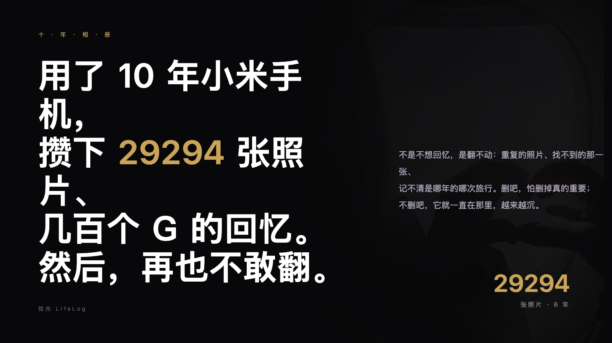
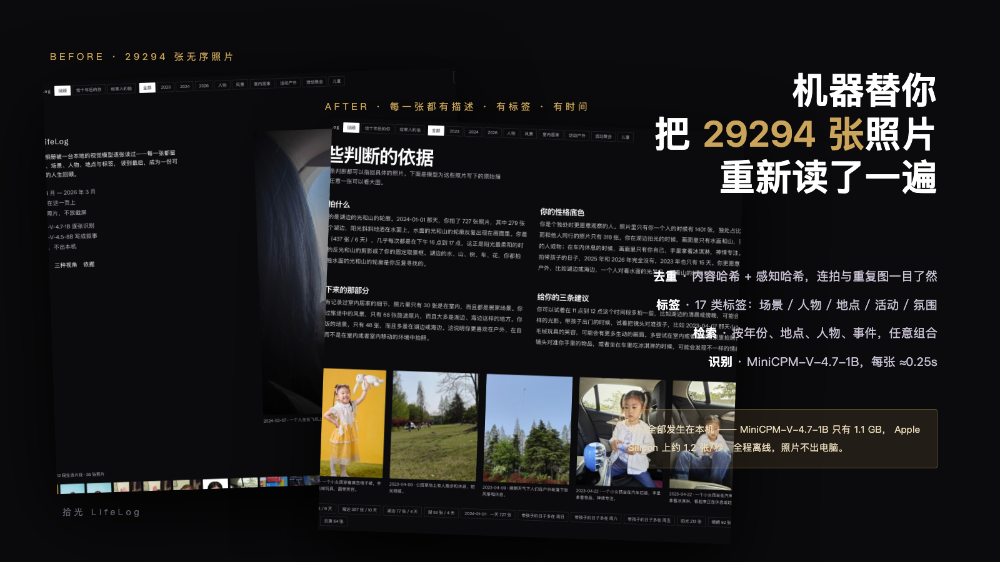
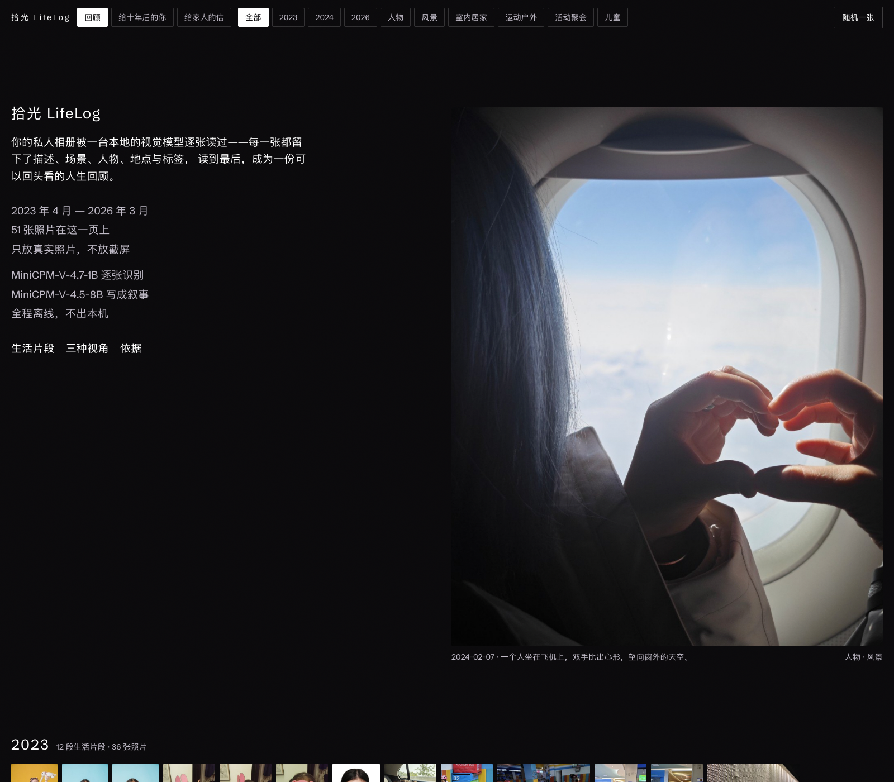
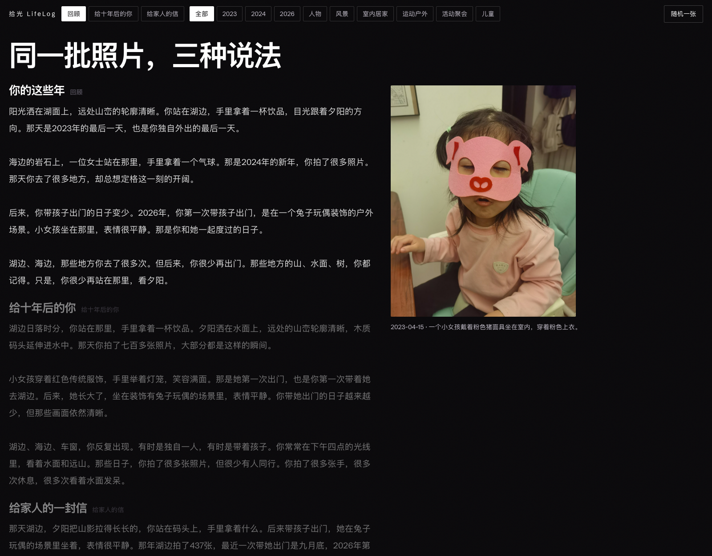
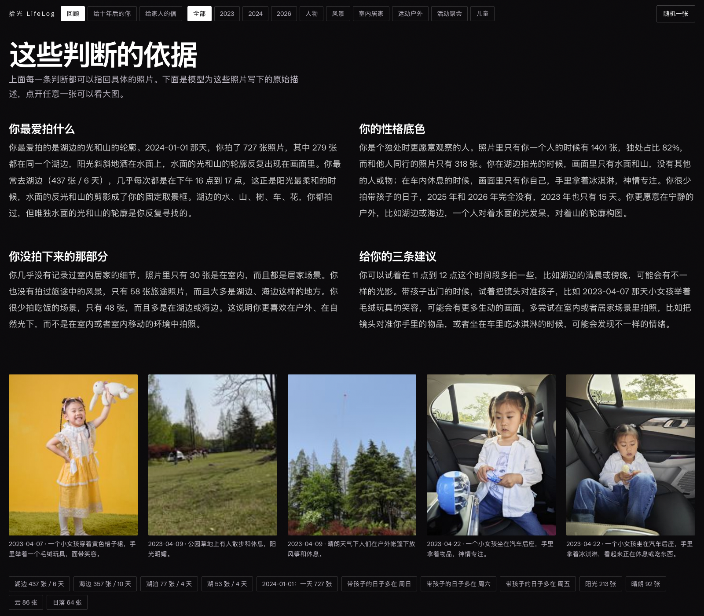

<div align="center">

# 拾光 LifeLog

**本地相册经 MiniCPM 逐张理解后，生成的一份可以回头看的人生回顾**

[](https://tailwindcss.com) [](https://github.com/OpenBMB/MiniCPM-V) [](https://github.com/ggml-org/llama.cpp) [](https://modelcontextprotocol.io)

[快速开始](#快速开始) · [三种叙事](#三种叙事视角) · [自我画像](#自我画像与依据) · [报名材料](docs/报名材料.md)

</div>
---
## 痛点

用了 10 年小米手机，攒下 **29294 张照片**、几百个 G 的回忆。

不是不想回忆，是**翻不动**：重复的照片、找不到的那一张、记不清是哪年的哪次旅行。删吧，怕删掉真的重要；不删吧，它就一直在那里，越来越沉。

拾光 LifeLog 做了三件事，然后写出第四件：

1. **去重** · 内容哈希 + 感知哈希，连拍、重复图、RAW+JPG 一目了然；
2. **重新整理** · 17 类标签 + 日期 + 地点 + 人物 + 活动 + 氛围，每张照片都归位；
3. **AI 识别** · MiniCPM-V-4.7-1B 逐张看图，写下「发生了什么」；
4. **人生回顾** · 把这些描述聚成天、串成片段、算出规律，最后由 MiniCPM-V-4.5-8B 写成三种叙事和一份「关于你的画像」，让你真的能**召回这十年**。

<div align="center">


</div>

---

## 为什么是 MiniCPM（而不是云端多模态大模型）

**这是一份本地优先的项目。** 相册是最隐私的数据，任何「上传到云端识别」的方案都意味着用户要交出十年生活的全部画面。所以模型的第一个硬指标是：**必须能在一台 16GB 内存的消费级电脑上、完全离线地跑完几万张照片。**

| 候选模型 | 最小可用体量 | 16GB Mac 可跑 | 逐张吞吐 | 结论 |
| --- | --- | --- | --- | --- |
| GPT-4V / Claude | — | 需上传 | — | 隐私红线，直接排除 |
| **MiniCPM-V-4.7-1B** | **1.1 GB (Q8)** | **可用** | **约 1.2 张/秒** | **主识别模型** |
| MiniCPM-V-4.5-8B | 5.0 GB (Q4) | 可用 (ctx 4096) | 约 40 s/篇 | **深度理解与写作** |
| MiniCPM-V-4.7-35B-A3B | 14.5 GB (IQ3) | 不可用 | — | 16GB 装不下 |

**选 MiniCPM 的三个理由：**

1. **体积**：1B 的 Q8 量化只有 1.1 GB，加载后占用约 2 GB 内存，是唯一能在 16GB 机器上和操作系统、浏览器、数据库**共存**并连续跑几小时的档位；
2. **速度**：Apple Silicon Metal 加速下实测 **1.2 张/秒（4 并发）**，5 万张的相册也能在半天内跑完，这让「全库理解」从演示变成日常；
3. **官方 GGUF 支持**：openbmb 直接发布 llama.cpp 可用的 GGUF，包括 1B、4.5-8B 和 OCR 专用模型，不用自己转格式。

**三级模型分工**（一张表说明为什么需要三个）：

| 模型 | 体量 | 角色 | 实测吞吐 |
| --- | --- | --- | --- |
| MiniCPM-V-4.7-1B (Q8) | 1.1 GB | 全库逐张识别：场景/人物/地点/活动/氛围/标签 | 1.2 张/秒 |
| MiniCPM-V-4.5-8B (Q4) | 5.0 GB | 深度理解 + 三种叙事 + 自我画像 | 约 40 s/篇 |
| MiniCPM-OCR-1.0 (Q8) | 0.8 GB | 截屏、订单、票据、路牌里的文字抽取 | — |

---

## 实测数据

**测试设备**：Apple M6 · 16 GB 统一内存 · macOS 27 · llama.cpp 0.8.0 · Python 3.15

**吞吐实测**（从 `data/lifelog.sqlite` 的真实识别时间戳反推）：

- MiniCPM-V-4.7-1B · 4 并发 · 1957 张耗时 **49 分钟**（约 0.67 张/秒 实际入库速率）
- 逐条间隔中位 1.00s（4 slot 并发下每 slot 约 0.25s/张）
- 写作类（4.5-8B）：单篇回顾 10-15s，一篇完整画像 22s，三种叙事共 16s
- **全库 29,294 张单轮约 6-7 小时**，挂机一晚跑完，支持断点续跑

**质量抽样**：226 张抽样全部产出可解析的结构化 JSON，其中 14 条最初无法解析（模型偶发漏一个逗号）——加入容错解析后 **0 张需要人工重跑**。

---

## 真实问答演示

`python scripts/gen_demo.py` 会从本机库生成一张自包含页面 `reports/demo/qa-demo.html`（双击即开）。它内嵌演示者的私人照片，所以不随仓库分发，只保留生成脚本。两轮问答长这样：

- **我在哪工作** —— 按「办公桌 / 工位 / 办公大厅」线索筛 2023 年，命中 32 张、21 个日期，其中 5 张带 GPS：杨浦东方渔人码头 A 区（2 张办公场景）、黄浦南京东路（30 天 / 93 张，其中 2 张工位）。
- **带朋友去哪** —— 推荐 2023-06-03~05 的三亚太阳湾：同一坐标段三天 958 张，全部有描述，户外 214 / 海边 184 / 室内 181 / 山野 52，高峰在 17 点与 22 点。

页面里同时放了原片缩略图、拍摄时间和当时的模型描述，可以直接核对。生成后也可以直接看 `http://127.0.0.1:8766/demo`。

---
## 演示

接触印相表（按年份铺开的全部照片）：



三种叙事（同一批照片的三种说法）：



自我画像（每条判断都挂着照片细节）：



**动态版本**见 `marketing/promo-slideshow.mp4`（19s 循环，3 MB）。**苹果风宣传片**见 `marketing/lifelog-apple-promo.mp4`（52 秒，1080p）。

---

## 快速开始

**要求**：Apple Silicon Mac（M 系列芯片）、16 GB 内存、Python 3.11+、Node 20+（编译 CSS）、小米云服务 App（如需从云端同步）。

```bash
# 1) 克隆
git clone https://github.com/lengjingxu/lifelog-minicpm.git
cd lifelog-minicpm

# 2) 装依赖
python3 -m venv .venv && .venv/bin/pip install pillow pillow-heif
npm install          # Tailwind CSS v4

# 3) 下载模型（首次约 2 GB，走 hf-mirror 可断点续传）
.venv/bin/python scripts/fetch_models.py minicpm-v-4.7-1b

# 4) 从小米云盘拉一个区间的照片（或直接用本地相册目录）
.venv/bin/python -m lifelog.cli sync --start 20240101 --end 20240331
# 或增量：.venv/bin/python -m lifelog.cli sync --incremental

# 5) 识别 + 聚合 + 画像与叙事，一条命令
.venv/bin/python -m lifelog.cli weekly --sample 100

# 6) 启动回顾页
.venv/bin/python -m lifelog.cli serve-web --port 8766
# 打开 http://127.0.0.1:8766/review
```

**只想看看效果**：`bash scripts/demo.sh /path/to/photos 4`，抽样 100 张照片，5 分钟内跑完整条链路。

---

## 多模型合并（这次修复的核心）

早期用 Qwen3-VL 跑过一批，后来换 MiniCPM-V-4.7-1B，结果库里同时存在两套描述，
统计直接把它们加在一起——覆盖率一度显示成 **188.5%**（55205 / 29294），
「独处占比」这类核心数字也被污染。

修法不是简单去重，而是把两批结果**合并**：

| 字段 | 规则 | 原因 |
| --- | --- | --- |
| 描述正文 | 以 MiniCPM 为主，副模型存 `caption_alt` 一并参与检索 | 换模型不该丢历史结果 |
| 场景 / 人物 / 地点 / 氛围 | **只取主模型** | 这些字段直接决定「独处占比」等结论 |
| 活动 | 主模型为空时用副模型补 | Qwen 这一列可靠 |
| 标签 | 两边归一到 17 类词表后取并集；「人物」只认主模型 | Qwen 会把空景误标成人物 |

- 词表在 `lifelog/config.py` 的 `TAG_TAXONOMY`（`户外/山野/海边/雪地 → 风景`，
  `手机/电脑/截图 → 屏幕截图`，`家具/家居 → 室内居家` …）
- 合并器 `scripts/merge_captions.py`，管线里以 `lifelog weekly` 的第 4 步自动执行
- 产物是 `merged_caption` 表 + `current_caption` 视图，所有查询统一读视图，
  避免口径再次漂移

结果：29283 张（99.96%），其中 **25922 张双模型交叉验证**，15980 张标签被补齐。

## 三种叙事视角

同一份事实底稿，三种不同的「说法」，页面顶部一键切换：

| 视角 | 读起来像什么 |
| --- | --- |
| **你的这些年** | 朋友翻完相册后当面跟你说话，挑几个具体瞬间讲这几年 |
| **给十年后的你** | 用陈述句交代当年的作息、陪伴和心境，不励志、不抒情 |
| **给家人的信** | 第一人称短信，只讲事实，结尾停在一件具体的小事上 |

写作约束（写进提示词）：短句、不比喻、不煽情、不升华、不堆形容词；数字必须原样引用程序算出的「事实白名单」，模型不得自行换算或编造。

示例（取自真实输出）：

> 2026 年 9 月 26 日，一个小女孩坐在装饰有兔子玩偶的户外场景里，表情很平静。
> 那是你这一年唯一一次带她出门。上一次，是 2024 年。
>
> 你拍过 437 张湖边，357 张海边，几乎都在下午四点的光线里。
> 你的相册里，82% 的画面只有你自己。

---

## 自我画像与依据

画像不是形容词堆砌，每条判断都挂着照片细节，页面下方直接展示**依据**：原始照片 + MiniCPM 写下的原始描述。

| 判断 | 依据（可核对） |
| --- | --- |
| 你最爱拍湖边的光和山的轮廓 | 湖边 437 张 / 6 天；2024-01-01 那天 727 张里 279 张在同一个湖边 |
| 你是个独处时更愿意观察的人 | 独处占比 82%（1401 / 318 张）；湖边拍照时画面里只有水面和山 |
| 带孩子的日子集中在周末 | 周六 35 张、周日 43 张，是平日（14 张）的 3 倍 |
| 你几乎不记录室内生活 | 室内只有 30 张，而户外 1342 张 |

---

## 接入 AI（MCP + Skill）

**MCP**（stdio，6 个工具）：

```json
{
  "mcpServers": {
    "lifelog": {
      "command": "/path/to/lifelog-minicpm/.venv/bin/python",
      "args": ["-m", "lifelog.mcp_server"],
      "cwd": "/path/to/lifelog-minicpm"
    }
  }
}
```

工具：`lifelog_ask`（自然语言问答）、`lifelog_search`、`lifelog_day`、`lifelog_profile`、`lifelog_journey`、`lifelog_events`。

**Skill**：`skills/lifelog/SKILL.md`，Agent 可以直接调用回答「我上个月常去哪」「带孩子出门几次」「帮我分析我的性格」这类问题。

---

## 架构

```
小米云盘相册（i.mi.com，RC4 解密）
        |  sync_xiaomi.py   只读云端、sha1 校验、断点续传、增量状态
        v
本地相册目录 -- ingest.py --> assets 表（路径、拍摄时间、GPS）
                                      |
                    caption.py / ocr.py | MiniCPM（llama.cpp 本地推理）
                                      v
                     captions 表（结构化描述 + 标签 + 图内文字）
                                      |
                    aggregate.py | 纯统计、幂等
                                      v
              days / events / profile（画像、三种叙事、事实白名单）
                                      |
              query.py ----------------------> CLI / MCP Server / 回顾页
```

**隐私**：推理全部走本机 llama.cpp，照片以本地 data URL 发给 127.0.0.1 的服务进程；不调用任何云端视觉 API；小米云盘同步只读云端、只写本地目录。

---

## 目录结构

```
lifelog-minicpm/
|-- lifelog/            # config / db / ingest / sync_xiaomi / models / caption / ocr / aggregate / story / journey / query / mcp_server / web
|-- skills/lifelog/     # Agent Skill
|-- scripts/            # fetch_models / demo.sh
|-- tests/              # 问答测试套件
|-- marketing/          # 宣传图与视频
|-- src/tailwind.css    # Tailwind v4 源
|-- docs/               # 架构 / 验收 / 报名材料
```

---

## License

MIT
